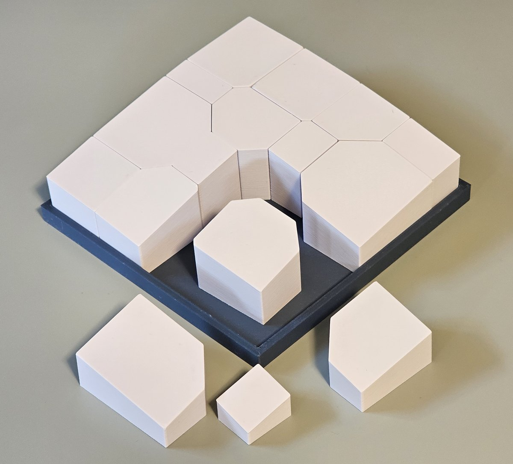

# MaxPlusLab

*Where mathematics becomes something you can play with.*

<table>
  <tr>
    <td align="center"></td>
    <td align="center"></td>
  </tr>
  <tr>
    <td align="center">Hill 16b-r, printed and partly assembled</td>
    <td align="center">Hill 9b in the browser, freshly scrambled</td>
  </tr>
</table>

### Play · Print · Explore

We turn ideas from tropical geometry into interactive and physical puzzles, and use computational experiments to discover what makes them interesting.

MaxPlusLab is an open collaboration between [Madeline V. Brandt](https://github.com/madeline-v-brandt) and [Igor Kuvychko](https://github.com/kuvychko).

## Projects

### Tropical Puzzle Lab

Tiling puzzles generated from tropical polynomials and rational functions. Each piece is one region cut out by a tropical curve; in relief mode its top is a tilted plane, and a correct assembly forms one continuous roof. Nine puzzles, each playable in relief or flat mode, in the browser or 3D-printed.

[Play in your browser](https://maxpluslab.github.io/tropical-puzzle-lab/) · [The mathematics](https://maxpluslab.github.io/tropical-puzzle-lab/?page=math) · [Make a physical puzzle](https://maxpluslab.github.io/tropical-puzzle-lab/?page=print) · [Printables collection](https://www.printables.com/@Igor_2829688/collections/3919682) · [Source](https://github.com/maxpluslab/tropical-puzzle-lab)

### Tiling Solvers

A laboratory for studying geometry, search, difficulty and structure: custom Rust search and OR-Tools CP-SAT, compared side by side on the same puzzles. One early finding: the third dimension changes the search problem. Laid flat, the 16 pieces of Hill 16a take over a million search nodes; with their roofs on, 68.

Corrugated 27a-r at a dead end. Built to be hard: without its roofs, our search has not yet been seen to finish.

[What we've learned so far](https://github.com/maxpluslab/tiling-solvers#what-weve-learned-so-far) · [Source](https://github.com/maxpluslab/tiling-solvers)

## Get involved

Curious about tropical geometry, puzzles, or computational mathematics? Play a puzzle, print one, or open an issue on [Tropical Puzzle Lab](https://github.com/maxpluslab/tropical-puzzle-lab/issues) or [Tiling Solvers](https://github.com/maxpluslab/tiling-solvers/issues).
