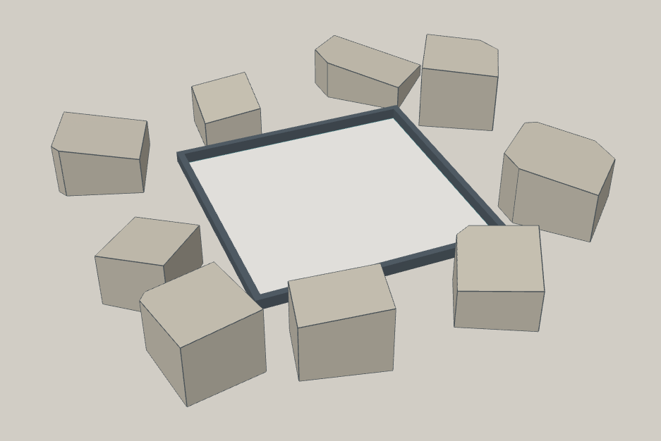
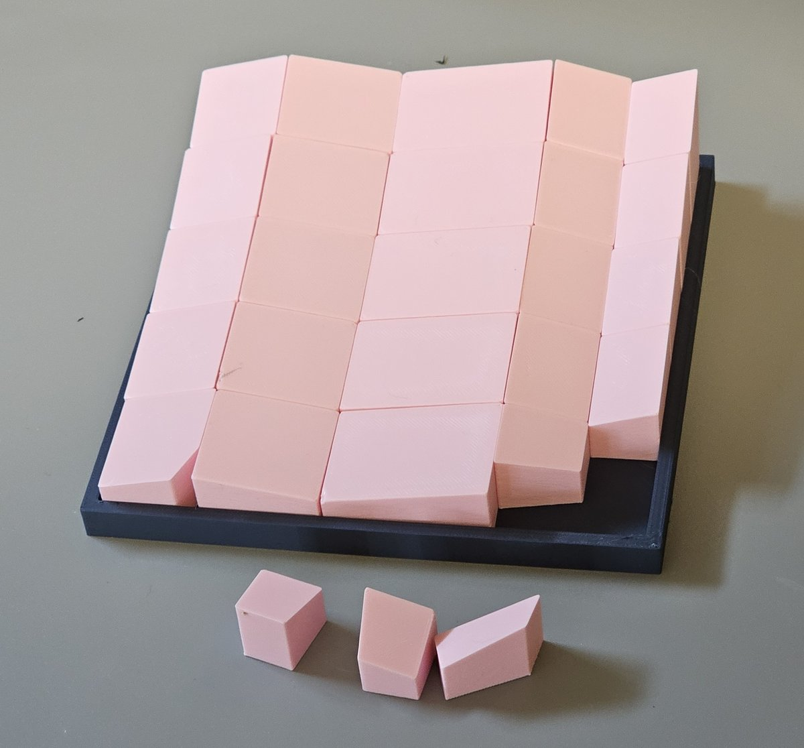

# MaxPlusLab

*Where mathematics becomes something you can play with.*

**[Play a puzzle](https://maxpluslab.github.io/tropical-puzzle-lab/)** · **[Print a puzzle](https://maxpluslab.github.io/tropical-puzzle-lab/?page=print)** · **[Explore the mathematics](https://maxpluslab.github.io/tropical-puzzle-lab/?page=math)** · **[Study the solvers](https://github.com/maxpluslab/tiling-solvers)**

<table>
<tr>
<td align="center"></td>
<td align="center"></td>
</tr>
<tr>
<td align="center">Hill 16b-r, printed and partly assembled</td>
<td align="center">Hill 9b in the browser, freshly scrambled</td>
</tr>
</table>

**MaxPlusLab** is an open collaboration between mathematician [Madeline V. Brandt](https://github.com/madeline-v-brandt) and scientist and engineer [Igor Kuvychko](https://github.com/kuvychko). We turn ideas from tropical geometry into interactive puzzles, 3D-printed objects, and computational experiments.

Our projects form a feedback loop: **mathematics generates puzzles; people and algorithms solve them; what we learn helps us design new ones.**

## Our projects

### Tropical Puzzle Lab — play, explore, print

A tropical polynomial or rational function divides a plane into regions. We turn those regions into pieces of a geometric tiling puzzle. In **flat mode**, the challenge is to fit the outlines together. In **relief mode**, each piece has a sloping top, and the completed puzzle forms a continuous surface.

Nine puzzle designs are playable in the browser in both modes. You can also generate STL files, 3D-print the pieces and tray, and explore the mathematics behind their construction.

[**Play the puzzles**](https://maxpluslab.github.io/tropical-puzzle-lab/) · [How the mathematics works](https://maxpluslab.github.io/tropical-puzzle-lab/?page=math) · [3D printing guide](https://maxpluslab.github.io/tropical-puzzle-lab/?page=print) · [Printables collection](https://www.printables.com/@Igor_2829688/collections/3919682) · [Code and puzzle definitions](https://github.com/maxpluslab/tropical-puzzle-lab)

### Tiling Solvers — learn what makes a puzzle hard

How do you solve a geometric puzzle without trying every possible position and rotation? And can computational search reveal what makes one puzzle more difficult than another?

Our [tiling-solvers](https://github.com/maxpluslab/tiling-solvers) project combines a Rust geometry and search engine, a Python research harness, an OR-Tools CP-SAT formulation, reproducible benchmarks, and an independent solution validator. It lets us compare algorithms, geometric constraints, and assumptions on the same puzzles.

[**Solver overview and findings**](https://github.com/maxpluslab/tiling-solvers#what-weve-learned-so-far) · [Algorithms](https://github.com/maxpluslab/tiling-solvers/blob/main/docs/algorithms.md) · [Experiments](https://github.com/maxpluslab/tiling-solvers/blob/main/docs/experiments.md) · [Source code](https://github.com/maxpluslab/tiling-solvers)

## What the experiments are teaching us

**A little height information can change the entire search.** For the 16-piece Hill 16a, a complete footprint search explored **1,064,878 nodes**. With the pieces' sloped roofs included, the same search explored just **68**. The roof profiles sharply restrict which edges can meet.

**Structure can matter even more than an improved algorithm.** Tropical subdivisions have an *edge-to-edge* structure. Restricting the same flat puzzle to edge-to-edge assemblies reduced its search to **49 nodes**. This is an explicit restriction on the allowed assemblies, not a general-purpose shortcut: flat pieces can sometimes form other, T-junction assemblies.

**Difficulty is not simply piece count.** The 11-piece Terrain 11a has **101** distinct footprint assemblies in our search but only **one** with its roofs. We've also designed **Corrugated 27a**, a 27-piece puzzle whose repeated ridge and valley heights deliberately make the relief search work harder.

Corrugated 27a-r at a dead end: an experiment in designing harder puzzles, not just solving existing ones.

*These figures count nodes in a particular solver's search, not execution time or human difficulty. Results are computational evidence under stated tolerances, not mathematical proofs of uniqueness.*

## Questions we're exploring

Can measurements from search help us design better difficulty ratings? Which geometric features make a puzzle hard for people, rather than just for an algorithm? Can we use the mathematics of tropical constructions to create new kinds of challenging, printable puzzles?

## Get involved

You don't need to know tropical geometry to participate. **Play a puzzle**, **print one**, or **tell us what made it easy or difficult**. If you're interested in mathematics, geometry, algorithms, or making things, explore the repositories and share an idea or open an issue:

[Tropical Puzzle Lab issues](https://github.com/maxpluslab/tropical-puzzle-lab/issues) · [Tiling Solvers issues](https://github.com/maxpluslab/tiling-solvers/issues)

Both projects are open source and developed in public.
